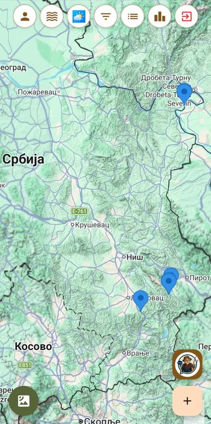
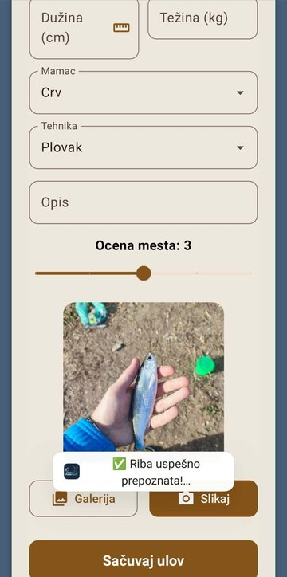
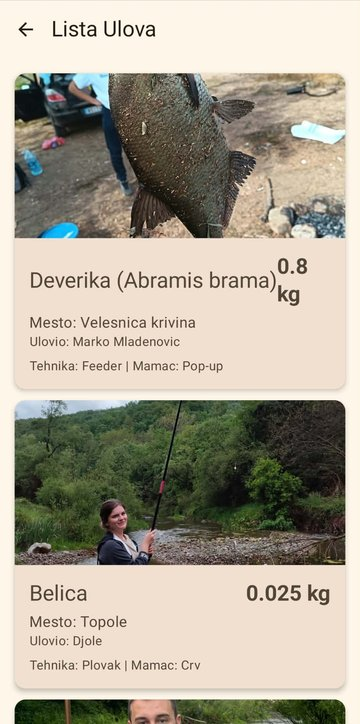
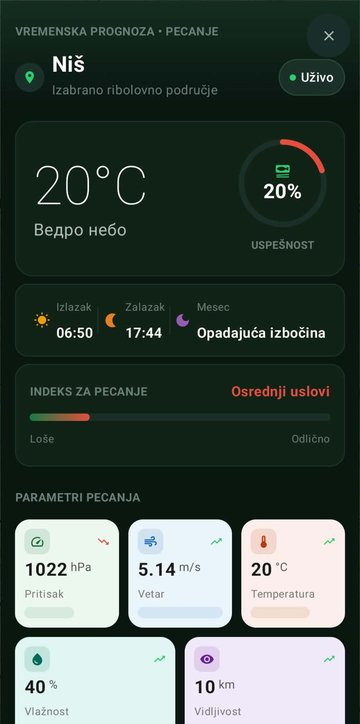
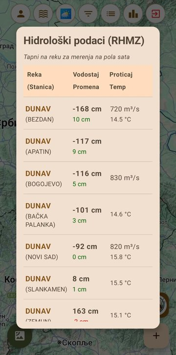

# FishSpot 🎣

**FishSpot** je Android aplikacija i društvena mreža za ribolovce. Korisnici objavljuju ulove i ribolovna mesta na mapi, prate vremensku prognozu i vodostaj reka, a model veštačke inteligencije na samom telefonu proverava da li fotografija ulova zaista sadrži ribu.

  
  
  

  
  

## Prepoznavanje ribe na fotografiji (AI)

Pre objave ulova aplikacija proverava da li se na fotografiji nalazi riba. Tako se sprečava objavljivanje nebitnih slika.

| | |
|---|---|
| **Arhitektura** | EfficientNetB1 (pretreniran na ImageNet-u) + sopstveni klasifikacioni sloj (Dense 256 → 128 → sigmoid) |
| **Pristup** | Transfer learning u dve faze: treniranje novog sloja, zatim fine-tuning poslednjih 30 slojeva |
| **Podaci** | 5.067 slika: 3.742 sa ribom, 1.325 bez ribe; podela 80/20 na trening i validaciju |
| **Obrada podataka** | Uklanjanje oštećenih i premalih slika, augmentacija (flip, rotacija, zoom, osvetljenje), težine klasa zbog neravnoteže |
| **Rezultat** | **98,4% tačnosti** na validacionom skupu (1.013 slika) |
| **Na telefonu** | Konverzija u TensorFlow Lite (7,3 MB), ulaz 256×256, izvršavanje na uređaju, bez interneta |
| **Alati** | Python, TensorFlow/Keras, Google Colab |

**U razvoju:** prepoznavanje **vrste** ribe sa fotografije.

## Funkcionalnosti

- **Mapa ribolovnih mesta**: Google Maps sa prikazom terena i satelita, markeri ulova i filtriranje.
- **Objava ulova**: fotografija, vrsta, dužina, težina, mamac, tehnika i ocena mesta.
- **Procena težine ribe** iz dužine po formuli W = a·L^b, sa koeficijentima za 30+ vrsta (FishBase).
- **Merenje dužine ribe** pomoću proširene stvarnosti (AR, Sceneform).
- **Provera lovostaja i minimalne mere** za domaće vrste riba.
- **Vremenska prognoza za pecanje**: pritisak, vetar, vlažnost, faza meseca i izračunat **indeks za pecanje**.
- **Vodostaj reka** u realnom vremenu, preuzet sa sajta RHMZ Srbije (stanje i merenja na svakih pola sata).
- **Rang lista** korisnika po poenima.
- **Komentari i push notifikacije**: Cloud Function šalje obaveštenje vlasniku ulova kad dobije komentar (FCM).
- **AI asistent** (chat bot, Gemini preko Firebase ekstenzije) za pitanja o ribolovu.
- **Rad bez interneta**: slika ulova se šalje u pozadini kada se veza vrati (WorkManager).

## Tehnologije

| Oblast | Tehnologije |
|---|---|
| Aplikacija | Kotlin, Jetpack Compose, Material 3, MVVM (ViewModel, StateFlow), Navigation Compose |
| Backend | Firebase Authentication (email i Google prijava), Cloud Firestore, Cloud Storage, Cloud Functions (Node.js), Cloud Messaging |
| Mape i lokacija | Google Maps SDK, Maps Compose, Fused Location Provider, OpenStreetMap Overpass API |
| Mašinsko učenje | TensorFlow Lite, EfficientNetB1, Python, TensorFlow/Keras |
| Mreža | Retrofit, Gson, Jsoup (preuzimanje podataka RHMZ), OpenWeatherMap, Open-Meteo, Geoapify |
| Ostalo | Sceneform (AR), WorkManager, Coil |

Bezbednost: pravila za Firestore i Storage ograničavaju pristup podacima na prijavljene korisnike i vlasnike sadržaja, a API ključevi se ne čuvaju u repozitorijumu (`local.properties` + Secrets Gradle Plugin).

## Pokretanje

1. Klonirati repozitorijum i otvoriti ga u Android Studio-u.
2. U `local.properties` dodati API ključeve (Google Maps, OpenWeatherMap, Geoapify).
3. Za sopstveni Firebase projekat zameniti `app/google-services.json` (paket `rs.fishspot.app`).
4. Pokrenuti na uređaju ili emulatoru sa Android 7.0 (API 24) ili novijim.

## Autor

**Đorđe Jovanović**, student Računarstva i informatike, Elektronski fakultet u Nišu
[github.com/zezus03](https://github.com/zezus03)
